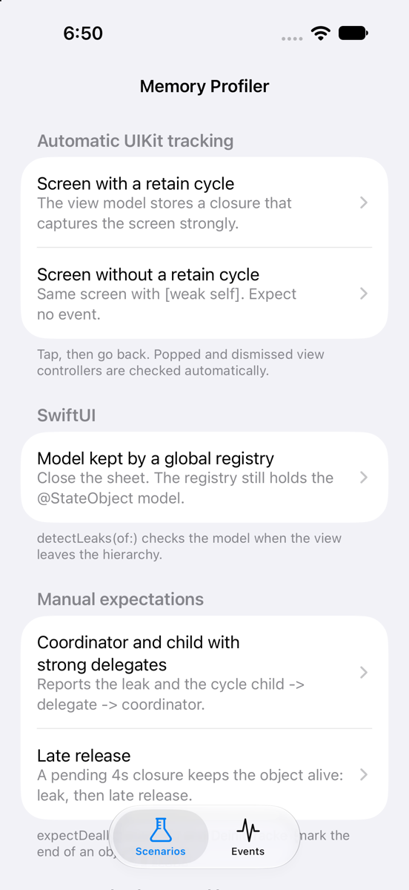
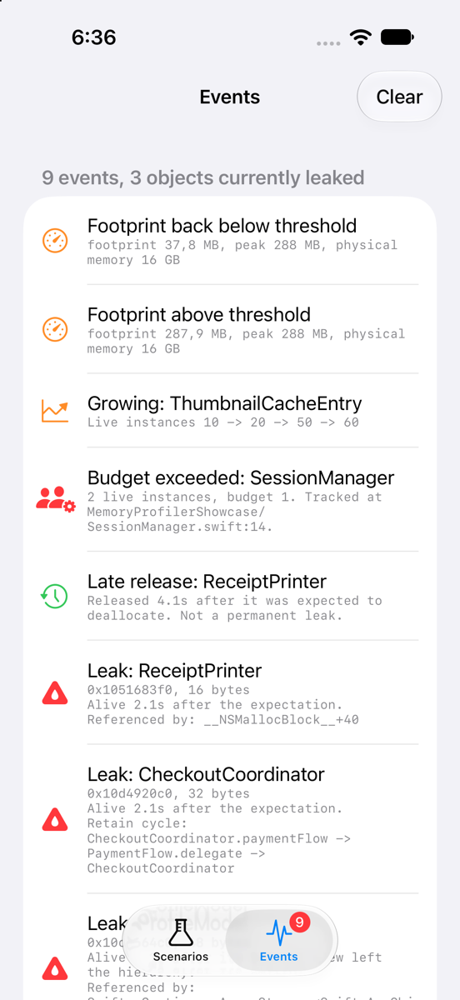

# MemoryProfiler

[](https://www.swift.org)
[](#requirements)
[](#installation)
[](https://github.com/egzonpllana/memory-profiler-ios/releases)
[](LICENSE)

Leak detection and memory monitoring for iOS and macOS apps. MemoryProfiler catches view controllers, views, SwiftUI models and any other object that outlives its scope. It names the retain cycle when there is one, flags classes that keep piling up, and watches the footprint the way jetsam does.

It asks one question: *did this object die when its scope ended?* That is different from asking whether memory is still reachable. Instruments' Leaks and the memory graph's leak markers only find unreachable cycles. MemoryProfiler also catches the objects they never report: a view model kept alive by a timer, a running task, a notification observer or a global registry.

<p align="center">
  
  &nbsp;&nbsp;
  
</p>

## Contents

- [Why MemoryProfiler?](#why-memoryprofiler)
- [Features](#features)
- [Requirements](#requirements)
- [Installation](#installation)
- [Quick start](#quick-start)
- [Catching leaks](#catching-leaks)
- [Events](#events)
- [Debugging a leak](#debugging-a-leak)
- [Footprint monitoring](#footprint-monitoring)
- [Heap census](#heap-census)
- [Configuration](#configuration)
- [Objective-C](#objective-c)
- [Showcase app](#showcase-app)
- [How it works](#how-it-works)
- [Limitations](#limitations)
- [Migrating from 2.x](#migrating-from-2x)

## Why MemoryProfiler?

Every object checks in through an initializer and is meant to check out through `deinit`. MemoryProfiler is the front desk. When a stay ends (a screen is popped, a sheet is dismissed, a flow completes), it notes the time and waits a moment. Then it knocks. A guest that answers has overstayed, and it is written into the ledger by name, room and the line of code that ended its stay. It follows the keys to find who still holds the door open. It counts the guests on every floor, so a crowd that grows night after night does not go unseen. It reads the building's capacity before the landlord does. When the late guest finally leaves, the ledger says so too. A leak is a guest that never checks out. MemoryProfiler is the desk that never forgets who checked in.

## Features

- **Automatic UIKit leak detection.** Popped, dismissed and removed view controllers, and their views, are checked without any app code.
- **SwiftUI.** `.detectLeaks(of: viewModel)` checks a view's models when the view leaves the hierarchy.
- **Manual expectations.** Use `expectDeallocation(of:)` or `DeinitTracker.expectDeinit(of:)` for any object whose scope just ended.
- **Late releases.** An object reported as leaked that is released later produces a `leakResolved` event, so slow releases are not confused with permanent leaks.
- **Instance budgets.** `trackInstance(self, budget: 1)` reports a second live instance of something that should be unique.
- **Retain cycle explanation (experimental).** A heap scan names the chain, for example `Screen.viewModel -> ViewModel.onChange -> heap block (32 bytes) -> Screen`.
- **Allocation growth detection.** Heap census sampling flags classes whose live instance count grows in every sample. Debug builds only.
- **Heap census.** Live instances and bytes per class, on demand. Debug builds only.
- **Jetsam-accurate footprint.** `phys_footprint`, the lifetime peak and the remaining headroom come from `TASK_VM_INFO`. The threshold uses hysteresis, and system memory pressure events are included.
- **One event stream.** Use `AsyncStream`, closure handlers, unified logging (`os.Logger`), and an optional assertion or debugger pause.
- **Swift 6.** Strict concurrency throughout, thread-safe, every component behind a protocol.
- **Objective-C bridge.** `MPMemoryProfiler`.

## Requirements

- iOS 16+ / macOS 13+
- Swift 6 toolchain (Xcode 16 or later)

## Installation

In Xcode, choose **File > Add Package Dependencies…** and enter `https://github.com/egzonpllana/memory-profiler-ios`.

Or add it to `Package.swift`:

```swift
dependencies: [
    .package(url: "https://github.com/egzonpllana/memory-profiler-ios.git", from: "3.0.0")
]
```

## Quick start

```swift
import MemoryProfiler

// In application(_:didFinishLaunchingWithOptions:) or your App initializer
MemoryProfilerService.shared.start()
```

That is all you need for UIKit. Pop a screen whose view model closure captures the screen strongly, and two seconds later the unified log shows this (verbatim output from the [showcase app](#showcase-app)):

```
Leak: MemoryProfilerShowcase.LeakyDetailViewController 0x1021bb200 (1280 bytes) is still alive 2.1s after its view
controller was removed. Filter the Debug Memory Graph by 0x1021bb200.
```

By default the profiler runs only when the package is built in the debug configuration (`.debugOnly`). In release builds every call is a no-op.

## Catching leaks

### Automatic UIKit tracking

On `start()` the profiler hooks `viewDidDisappear(_:)`. When a view controller, or one of its ancestors, is popped, dismissed or removed from its parent, the profiler expects that controller and all its children, plus their root views, to deallocate within the grace period. Tab switches and covering presentations do not count.

When the deadline arrives, a controller that is back in use (re-pushed, re-presented or re-parented) is not reported. A view still owned by a living controller is covered by the controller's own report.

Apple framework controllers are skipped by default, because UIKit caches some of its own. Keep a controller alive on purpose, for example in a coordinator cache or as page view controller data? Opt it out:

```swift
final class CachedPageViewController: UIViewController, LeakDetectionExempt {}
```

### SwiftUI

Apply the modifier in the view that owns the model:

```swift
struct ProfileScreen: View {
    @StateObject private var model = ProfileModel()

    var body: some View {
        Text(model.name)
            .detectLeaks(of: model)
    }
}
```

When SwiftUI tears down the view's state, the model is expected to deallocate. If something else still holds it, for example a global registry, the profiler reports it, even though reachability-based tools would not:

```
Leak: MemoryProfilerShowcase.ProfileModel 0x10cf0dd70 (48 bytes) is still alive 2.1s after its SwiftUI view left the
hierarchy. Expected at MemoryProfilerShowcase/ProfileScreen.swift:36 in body. Filter the Debug Memory Graph by
0x10cf0dd70. Referenced by (conservative scan): Swift._ContiguousArrayStorage<Swift.AnyObject>+32.
```

The profiler comes from `EnvironmentValues.memoryProfiler`, which defaults to `.shared`.

### Any object

Declare the end of an object's scope:

```swift
func finishCheckout() {
    if let coordinator {
        MemoryProfilerService.shared.expectDeallocation(of: coordinator)
    }
    coordinator = nil
}

// or, without a profiler reference:
DeinitTracker.expectDeinit(of: coordinator, within: .seconds(5))
```

The object is held weakly. Its deallocation is observed exactly, through an associated object, so nothing polls. The check runs on the main thread when the grace period ends. An object that is still alive is reported once. If it is released later, `leakResolved` reports how long it lingered:

```
Late release: MemoryProfilerShowcase.ReceiptPrinter 0x104964430 deallocated 4.2s after the expectation; it was not
a permanent leak.
```

### Instance budgets

```swift
final class SessionManager {
    init() {
        MemoryProfilerService.shared.trackInstance(self, budget: 1)
    }
}
```

When a second instance is alive at the same time, `instanceBudgetExceeded` is reported. It is reported again only after the count drops back within the budget:

```
Instance budget exceeded: 2 live MemoryProfilerShowcase.SessionManager instances, budget 1. Latest tracked at
MemoryProfilerShowcase/SessionManager.swift:14.
```

### Retain cycle explanation (experimental)

```swift
var configuration = MemoryProfilerConfiguration()
configuration.leakDetection.diagnostics.retentionAnalysis = .referrerScan(maxDepth: 3)
MemoryProfilerService.shared.configure(configuration)
```

Once a leak is confirmed, the profiler walks the malloc heap breadth first. It looks for blocks that point at the leaked object, then for blocks that point at those, and so on. If the chain leads back to the object, the cycle is reported. Field names come from the runtime's instance variable metadata.

```
Possible retain cycle (conservative scan): MemoryProfilerShowcase.LeakyDetailViewController.viewModel
-> MemoryProfilerShowcase.DetailViewModel.onChange -> heap block (32 bytes)
-> MemoryProfilerShowcase.LeakyDetailViewController.
```

When there is no cycle, the direct referrers are listed instead, as in the SwiftUI example above.

The scan is conservative. Any pointer-sized word equal to the object's address counts as a reference, so Objective-C `weak` and Swift `unowned` references can show up as edges. Swift `weak` references are excluded exactly. Cycles that pass only through app classes and closure contexts are preferred over cycles through framework back-pointers. The scan runs in debug builds only and briefly pauses every allocating thread. Use it as a lead, and confirm in the Debug Memory Graph.

### Allocation growth

```swift
configuration.allocationGrowth = .enabled(
    AllocationGrowthPolicy(sampleInterval: .seconds(60), consecutiveIncreases: 4, minimumInstanceIncrease: 5)
)
```

Each sample counts the live instances of every application class. A class whose count increases in every sample of the window is reported once:

```
Allocation growth: MemoryProfilerShowcase.ThumbnailCacheEntry instances 10 -> 30 -> 50 -> 70, holding 2 kB.
```

`holding` counts each instance's own allocation only. Buffers the instances point to, such as array storage, are separate blocks.

## Events

Every finding is a `MemoryProfilerEvent`:

| Event | Meaning |
|---|---|
| `.leakDetected(LeakReport)` | Alive past its expected deallocation plus the grace period |
| `.leakResolved(LeakResolution)` | A reported object was released later (a late release) |
| `.instanceBudgetExceeded(InstanceBudgetViolation)` | More live instances than the budget |
| `.allocationGrowthDetected(AllocationGrowthSuspect)` | A class kept accumulating instances |
| `.thresholdExceeded(MemoryStats)` / `.thresholdRecovered(MemoryStats)` | Footprint crossed the warning threshold, or fell back below it |
| `.systemMemoryPressure(MemoryPressureLevel)` | Kernel memory pressure changed |

```swift
Task {
    for await event in MemoryProfilerService.shared.events {
        if case .leakDetected(let report) = event {
            analytics.track("leak", ["type": report.object.typeName])
        }
    }
}

let subscription = MemoryProfilerService.shared.addEventHandler { event in /* private serial queue */ }
subscription.cancel()
```

Every event is also written to the unified log. Filter on subsystem `com.egzonpllana.MemoryProfiler`; the categories are `lifecycle`, `monitoring`, `leaks` and `heap`. To route the messages to your own logging stack, pass a `MemoryLogging` implementation to `MemoryProfilerService(configuration:logger:)`.

## Debugging a leak

```swift
configuration.leakDetection.alertPolicy = .breakpoint
```

With a debugger attached, the app pauses on the main thread when a leak is detected, while the object is still alive. Open **Debug Memory Graph** and paste the reported address into the filter. Xcode shows the full retain graph. With `.assertionFailure` a debug build stops instead. With `.log`, the default, the leak is only logged.

## Footprint monitoring

```swift
let stats = MemoryProfilerService.shared.currentStats()
print(stats?.description ?? "inactive")
// On a device: footprint 412 MB, peak 530 MB, limit 2.9 GB (14%)

MemoryProfilerService.shared.logMemoryUsage(context: "After import")
```

- `footprint` is `phys_footprint`, the number jetsam and Xcode's memory gauge use, not `resident_size`.
- `limit` is the footprint plus `limit_bytes_remaining`, which is the real per-process limit on iOS. macOS and the Simulator have no limit, so `limit` is `nil` there and physical memory is used instead.
- The default threshold is `.fractionOfLimit(0.8)`. It publishes one event when the footprint crosses the threshold and one when it recovers below 95% of it, never one per sample.

## Heap census

```swift
let census = try MemoryProfilerService.shared.heapCensus(limit: 10, scope: .applicationTypes)
for entry in census.entries {
    print(entry.typeName, entry.instanceCount, entry.totalBytes)
}
```

The census works in debug builds only. Release builds throw `HeapCensusError.introspectionUnavailable` and contain no reference to the runtime symbols it uses.

## Configuration

```swift
var configuration = MemoryProfilerConfiguration(environment: .debugOnly)   // or .all for QA builds
configuration.monitoring = MonitoringConfiguration(interval: .seconds(30), warningThreshold: .fractionOfLimit(0.8))
configuration.leakDetection = LeakDetectionConfiguration(
    gracePeriod: .seconds(2),
    automaticTracking: [.viewControllers, .views],
    alertPolicy: .log,
    filter: LeakDetectionFilter(ignoredTypeNames: ["MyApp.ImageCache"], ignoresSystemTypes: true),
    diagnostics: LeakDiagnosticsConfiguration(capturesCallStack: true, retentionAnalysis: .disabled)
)
configuration.allocationGrowth = .disabled
MemoryProfilerService.shared.configure(configuration)
```

The lifecycle methods are `start()`, `stop()`, `enable()` and `disable()`, and `state` reports `.idle`, `.monitoring` or `.disabled`. Manual expectations work without `start()`. Automatic tracking, sampling and pressure observation run between `start()` and `stop()`.

For dependency injection, create your own `MemoryProfilerService` and inject it as `any MemoryProfilerServicing`. Note that `DeinitTracker`, the Objective-C bridge and the default SwiftUI environment value always use `.shared`.

## Objective-C

```objc
@import MemoryProfiler;

[MPMemoryProfiler start];
[MPMemoryProfiler expectDeallocationOf:self.viewModel];
[MPMemoryProfiler trackInstance:self budget:1];
[MPMemoryProfiler setLeakHandler:^(MPLeakReport *report) {
    NSLog(@"%@", report.summary);
}];
```

Automatic UIKit tracking works for Objective-C view controllers too. The leak handler runs on a background queue.

## Showcase app

`Example/MemoryProfilerShowcase.xcodeproj` demonstrates every feature with real leaks:

- A screen whose view model closure captures it strongly, next to the same screen written with `[weak self]`
- A SwiftUI model kept alive by a global registry
- A coordinator and child flow with strong delegates
- A late release
- A budget-limited `SessionManager`
- A cache that never evicts
- A 250 MB allocation that crosses the threshold

Tap a scenario in the **Scenarios** tab. The **Events** tab shows what the profiler reports, live.

To run every scenario unattended, install the app on a booted simulator and launch it with `-runAllScenarios`. The transcript is printed to the console:

```sh
xcrun simctl launch --console-pty booted com.egzonpllana.MemoryProfilerShowcase -runAllScenarios
```

The project is generated from `Example/project.yml` with [XcodeGen](https://github.com/yonaskolb/XcodeGen).

## How it works

```
Sources/MemoryProfiler/
  Domain/        Models, protocols, and the engines (leak detection, budgets, growth analysis,
                 threshold hysteresis, monitoring and growth coordinators). No platform code.
  Data/          Kernel and runtime adapters: TASK_VM_INFO reader, dispatch timers and pressure source,
                 associated-object deallocation sentinel, runtime inspection, heap census, referrer scan.
  Presentation/  MemoryProfilerService facade, event broadcaster, logging, alert policy,
                 UIKit, SwiftUI and Objective-C integrations.
Sources/MemoryProfilerNative/   C: malloc zone walker (census, referrer scan) and TASK_VM_INFO reader.
```

- **Deallocation is observed, not polled.** A sentinel object is attached to the tracked object as an associated object. Its `deinit` runs when the tracked object is destroyed, for both NSObject subclasses and native Swift classes.
- **Deadline checks run on the main thread.** The temporary strong reference taken during the check can then never be the last one released off the main thread, which UIKit objects forbid.
- **The heap walk locks each malloc zone in turn.** The per-block callback is plain C and never allocates. The profiler stores the addresses of tracked objects bit-inverted, as the Objective-C runtime does, so its own bookkeeping never shows up as a referrer.

## Limitations

- Instances of generic classes are not counted by the census, because their runtime-created metadata is not listed by the Objective-C runtime. They can still be leak-checked by expectation.
- Retention analysis is a conservative scan, not a precise graph: confirm cycles in the Debug Memory Graph.
- Automatic tracking cannot tell a removed controller that is cached on purpose from a leaked one. Opt such controllers out with `LeakDetectionExempt` or `ignoredTypeNames`.
- AppKit has no automatic tracking. On macOS, use expectations, budgets, census and monitoring.
- Heap census, growth detection and retention analysis are compiled into debug builds only.

## Migrating from 2.x

| 2.x | 3.0 |
|---|---|
| `trackObject(_, expectedLifetime: .scopeBound)` + `detectMemoryLeaks()` | `expectDeallocation(of:)` when the scope ends; leaks arrive as events |
| `trackObject(_, expectedLifetime: .timeBound(seconds:))` | `expectDeallocation(of:within:)` |
| `detectMemoryLeaks()` | `currentLeaks()` or the `events` stream |
| `MemoryLeakInfo` | `LeakReport` (address, size, reason, location, call stack, retention) |
| `SnapshotDiffEngine` with manual counts | `allocationGrowth = .enabled(...)`, fed by the heap census |
| `startMonitoring()` / `stopMonitoring()` | `start()` / `stop()` |
| `getMemoryStats()` (`resident_size`) | `currentStats()` (`phys_footprint`, peak, limit) |
| `setMemoryWarningThreshold(_:)` | `configuration.monitoring.warningThreshold` |
| `MemoryProfilerService(isEnabled:environment:monitor:scheduler:leakDetector:logger:)` | `MemoryProfilerService(configuration:logger:)` |
| `ConsoleMemoryLogger` (`print`) | `OSLogMemoryLogger` (unified logging), or your own `MemoryLogging` |

## License

MemoryProfiler is available under the MIT license. See [LICENSE](LICENSE) for details.
